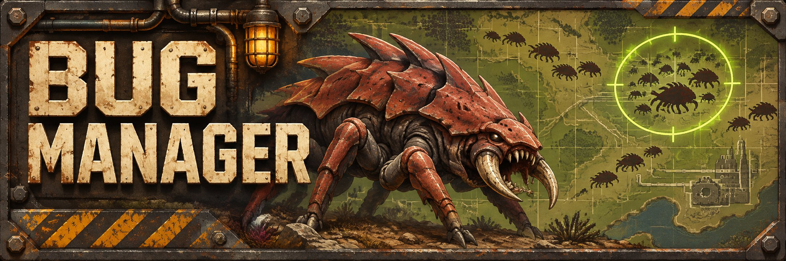

<h1 align="center">
  
</h1>

  Follow friendly swarms on the Factorio map and share the terrain they discover with the teams you choose.

  <strong>Source version</strong> <a href="friendly-bug-map/info.json"><code>1.3.9</code></a>
  &nbsp;·&nbsp; <strong>Factorio</strong> <code>2.1</code>
  &nbsp;·&nbsp; <strong>License</strong> <a href="LICENSE">MIT</a>

  <strong><a href="https://mods.factorio.com/mod/friendly-bug-map">Get Bug Manager on the Mod Portal</a></strong>
  &nbsp;·&nbsp; <a href="#set-up-team-sharing">Quick setup</a>
  &nbsp;·&nbsp; <a href="friendly-bug-map/changelog.txt">Changelog</a>

## On the map

A single marker can read **Fox Swarm: 237 bugs**. Nearby bugs share an icon, larger groups take priority, and eligible bugs beyond the marker limit can still reveal terrain. The swarm keeps its existing orders.

| What you want to do | Where to find it |
| --- | --- |
| **Hide details on your map** | In remote view, click the **biter** in the map toolbar. **1** shows icons and counts. **0** hides them for you. Your choice survives reconnects. Teammates keep their own views, and discovery and ordinary map blips continue. |
| **Find a particular swarm** | Open the marker panel with `/bug-map reset-ui`. Type a source team or its map name in **Find a group**, select a result, then click **Locate group**. Results are on your current surface and respect remote-view permissions. |
| **Configure your team’s map** | As an admin, click **Bug Manager** beside the hotbar. Choose the source teams to display, name their swarms or edit sharing rules. Use the **⋮** menu beside the hotbar to pin the shortcut. |

  
  

  Open the <a href="docs/images/group-search.png">group finder</a> or the <a href="docs/images/sharing-rule.png">sharing-rule editor</a> at full size.

## Set up team sharing

1. **Install the mod.** Find **Bug Manager** in Factorio’s mod browser. Use the same game version and enabled mod versions on the server and joining clients.
2. **Choose the teams.** As an admin, open the hotbar shortcut and select **Add first sharing rule**. Pick the **Source force** that owns the bugs and the **Receiving force** that should see their information. To add another rule, use **Sharing rules → Add rule**, or open the list with `/bug-map config`.
3. **Choose what to share.** Enable markers, terrain discovery, map refresh or any combination. Read the direction and radius in the preview, then click **Apply**.

> **Example** · With **Swarm → Builders**, Builders can follow Swarm’s bugs. Tick **Share in both directions** if Swarm should also receive map information from Builders’ eligible bugs.

New saves start with an empty rule list. Under **Advanced filters**, the disabled creature checkboxes show the server defaults. Enable **Override default entity filters** to choose different creatures for this rule. In marker settings, leave **Map name** blank to display the source team’s actual name.

## Multiplayer and upgrades

Base Factorio 2.1 is the only requirement. If you use Informatron 0.5.0 or later, open its **Bug Manager** entry for the in-game guide. Markers and terrain update periodically. Discovered terrain stays on the map after a swarm moves away. Zoomed-in remote viewing follows Factorio’s normal live-visibility rules.

Back up the server save before upgrading. Version **1.3.9** was tested on **Factorio 2.1.23** with one graphical client connected to a 75-mod dedicated server. Direct upgrades and restarts passed from all 16 earlier tracking builds, including 1.3.8.

## Working with the source

- **Run a development copy.** Copy `friendly-bug-map/` into Factorio’s `mods/` directory and use one copy of Bug Manager at a time. Keep the internal name `friendly-bug-map` so existing saves recognise it. [Mod source](friendly-bug-map/) · [Version and dependencies](friendly-bug-map/info.json)
- **Contribute a translation.** Copy the English locale files into `locale/<language-code>/` inside the mod. Translate the values after each `=` and preserve keys and placeholders such as `__1__`. [English locale files](friendly-bug-map/locale/en/)

Created by **Killerdash117**.
