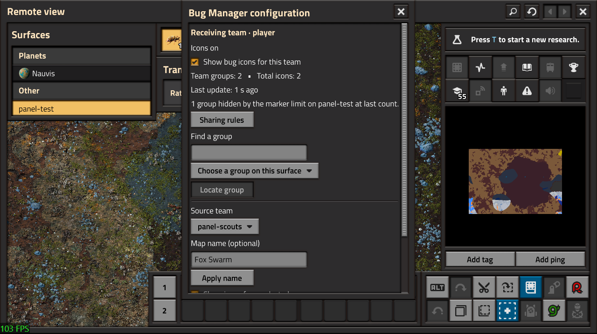

<h1 align="center">
  
</h1>

  <strong>Follow a whole swarm with one map marker.</strong> 
  See where your friendly bugs are heading, count them at a glance and share the terrain they uncover.

  <a href="friendly-bug-map/info.json">Source version <strong>1.3.14</strong></a>
  &nbsp;·&nbsp; Factorio <strong>2.1</strong> (tested on <strong>2.1.25</strong>)
  &nbsp;·&nbsp; <a href="LICENSE">MIT license</a>

  <strong><a href="https://mods.factorio.com/mod/friendly-bug-map">Install from the Mod Portal</a></strong>
  &nbsp;·&nbsp; <a href="#on-the-map">Player controls</a>
  &nbsp;·&nbsp; <a href="#set-up-team-sharing">Admin setup</a>
  &nbsp;·&nbsp; <a href="#multiplayer-and-upgrades">Server guide</a>
  &nbsp;·&nbsp; <a href="friendly-bug-map/changelog.txt">Changelog</a>

## On the map

A group labelled **Fox Swarm: 237 bugs** shows where those bugs were last seen together. The marker follows them as tracking updates. They keep their existing movement and combat orders.

**Show or hide your swarm details.** In remote map view, click the biter in the shared mod toolbar. A **plain biter** means icons, names and counts are on. A **crossed-out biter** means they’re hidden on your map. Your choice survives reconnects. Teammates keep their own views, and discovery, map refresh and ordinary Factorio blips continue.

**Find a group.** Type `/bug-map reset-ui` to open or centre your marker panel. Under **Find a group**, search by source team or its custom map name. Select a result and click **Locate group** to centre remote view on its last known charted position. Results follow the surface you’re viewing. Zoomed-in live viewing still needs normal Factorio visibility.

   
  <em>The group finder lists larger swarms first and flags groups hidden by the marker limit.</em>

## Set up team sharing

> [!TIP]
> **Just installed?** The rule list starts empty. Choose two teams that already exist in your save. One owns the bugs and the other receives their map information.

1. **Open the admin shortcut.** Click **Bug Manager** beside the hotbar and choose **Add first sharing rule**. If the shortcut is hidden, pin it from the **⋮** menu. You can also open **Sharing rules** with `/bug-map config`.
2. **Choose a direction.** For **Swarm → Builders**, set **Source force** to *Swarm* and **Receiving force** to *Builders*. Builders will receive information from Swarm’s eligible bugs. Tick **Share in both directions** to share the other way as well.
3. **Choose the outputs.** Enable any combination below, check the direction and radius in the preview, then click **Apply**. Use **Sharing rules → Add rule** to track another team.

| Rule output | What Builders sees in this example |
| --- | --- |
| **Show markers** | Icons and labels for Swarm’s eligible bugs. |
| **Discover terrain** | New terrain around those bugs, which stays charted after they leave. |
| **Refresh discovered terrain** | Periodic updates around those bugs in chunks Builders has already charted. |

   
  <em>The preview above Apply shows exactly what the receiving team will get.</em>

### Make a busy map readable

- **Name or filter a source.** Open **Expand team display settings** in the admin panel. Choose a source, enter a **Map name** and click **Apply name**. Apply a blank name to restore the team name. These choices affect everyone on the receiving team.
- **Choose a display preset.** **Minimal** groups bugs and shows counts. **Balanced** adds source names. **Detailed** shows individual units and their types.
- **Keep scouts visible and text sparse.** Set **Show bug icons from** to 1 and **Show bug labels from** to 10. A group of nine keeps its icon and exact finder count. Individual units count as one. Both thresholds default to 1 and apply only to mobile bugs.
- **Keep nests on a crowded map.** Set **Reserved nest slots** and click **Apply marker limits**. With a cap of 32 and four reserved slots, up to four eligible nest markers get priority on each surface. Unused slots go to the largest remaining groups. The default reservation is zero. Discovery and refresh continue beyond the display limits.
- **Distinguish sources.** Select a source and set a short prefix such as **N** and a label colour such as `#FFD166`. Click **Apply label style**. Clear the fields to restore the defaults. Each receiving team has its own styles.
- **Narrow one rule.** Open **Advanced filters** and enable the relevant override to choose creatures or surfaces for that rule. You can include modded units, exclude a soldier prototype, or skip space platforms and sandbox surfaces. For nest icons, enable both spawner tracking in the rule or map defaults and **Show tracked nests** for the receiving team.

## Multiplayer and upgrades

Install **Bug Manager** from Factorio’s mod browser and use matching game and mod versions on the server and joining clients. **Base Factorio 2.1 is the only requirement.** With optional **Informatron 0.5.0 or later**, press **I** (default) and select **Bug Manager**. Open **My map** for the toolbar icons or **Marker styles** for a worked example of thresholds, nest slots and colour. [Preview the in-game guide](docs/images/informatron-guide.png).

<strong>Missing a swarm or seeing an old position?</strong>

- **Ordinary blips but no labels.** Check the biter button in remote view, then read your status in `/bug-map reset-ui`. An admin can check the server’s **Show bug markers** switch, the receiving team’s source filter and whether an active rule shares markers on this surface. A rule referencing a missing team waits until that team exists or the rule is edited.
- **An empty group finder.** Check the viewed surface and clear the search. Individual-marker mode has no grouped entries to locate. The panel reports when the marker limit hides groups.
- **A position that looks old.** Check **Last update** in the panel. An admin can inspect `/bug-map status` and use `/bug-map refresh` to queue a pass. If tracking is stopped, resume it with `/bug-map on`.

<strong>Updating an existing save or removing the mod</strong>

Apply any open rule edits, back up the save and install the same mod version on the server and clients. Loading the save upgrades tracking automatically. Sharing rules, custom names, personal display choices and player-created tags carry forward. Upgrades from the older team-wide marker system remove its tags and use personal overlays. If an older panel closes, reopen it with the hotbar shortcut or `/bug-map reset-ui`.

To pause tracking for everyone and remove Bug Manager’s markers, use `/bug-map off`. Before uninstalling, run `/bug-map clear`, save the game, stop the server and remove the mod. Discovered terrain remains on the map.

<strong>Performance and testing for 1.3.14</strong>

With 2,503 tracked bugs, the largest saving was on the map where two teams received grouped markers. For less frequent updates, choose **Settings → Mod settings → Map → Performance preset → Low load**.

| Marker mode | Receiving teams | 1.3.13 | 1.3.14 |
| --- | ---: | ---: | ---: |
| Grouped | 1 | 0.366 ms/tick | 0.241 ms/tick |
| Grouped | 2 | 0.475 ms/tick | 0.260 ms/tick |
| Individual | 2 | 0.398 ms/tick | 0.238 ms/tick |

Each value is the median of three alternating 600-tick run averages on the same save, using base Factorio **2.1.25** and Bug Manager. These measure script update time. Frame rate and sustained performance on a live modded server can differ.

All 21 earlier tracking builds upgraded and restarted on disposable saves. A dedicated server loaded 80 enabled mods including Bug Manager. One graphical client exercised the personal map controls, admin marker settings and the seven-page Informatron guide. Simultaneous graphical clients were outside this test.

## Working with the source

For a development copy, place the `friendly-bug-map/` directory in Factorio’s `mods/` directory and load one copy of the mod. Keep the internal name `friendly-bug-map` so existing saves recognise it. [Browse the Lua source](friendly-bug-map/) · [Version and dependencies](friendly-bug-map/info.json)

To contribute a translation, copy the English locale files to `locale/<language-code>/` inside the mod. Translate the values after `=` and preserve the keys and placeholders such as `__1__`. [English locale files](friendly-bug-map/locale/en/)

Created by **Killerdash117**.
